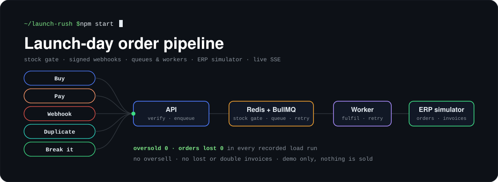
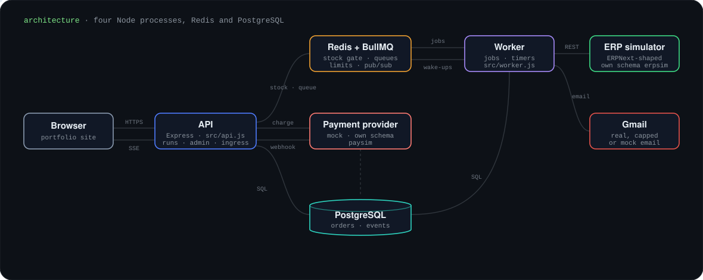
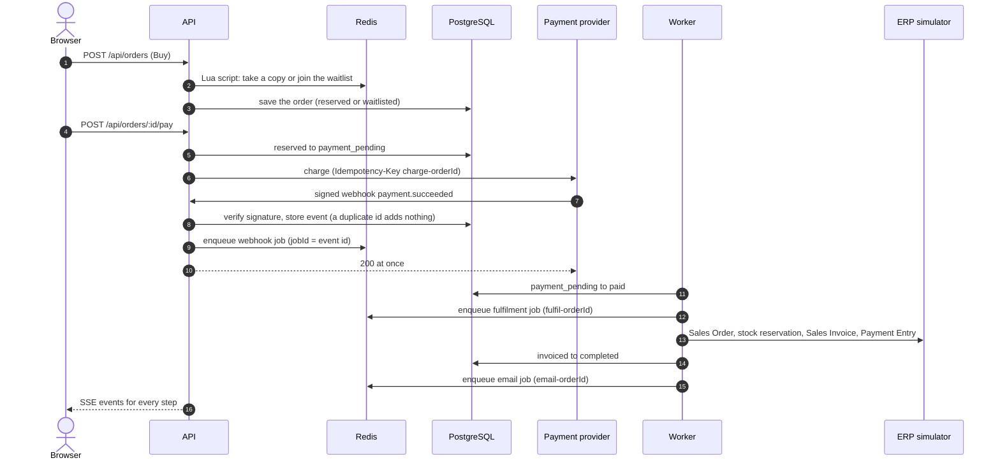
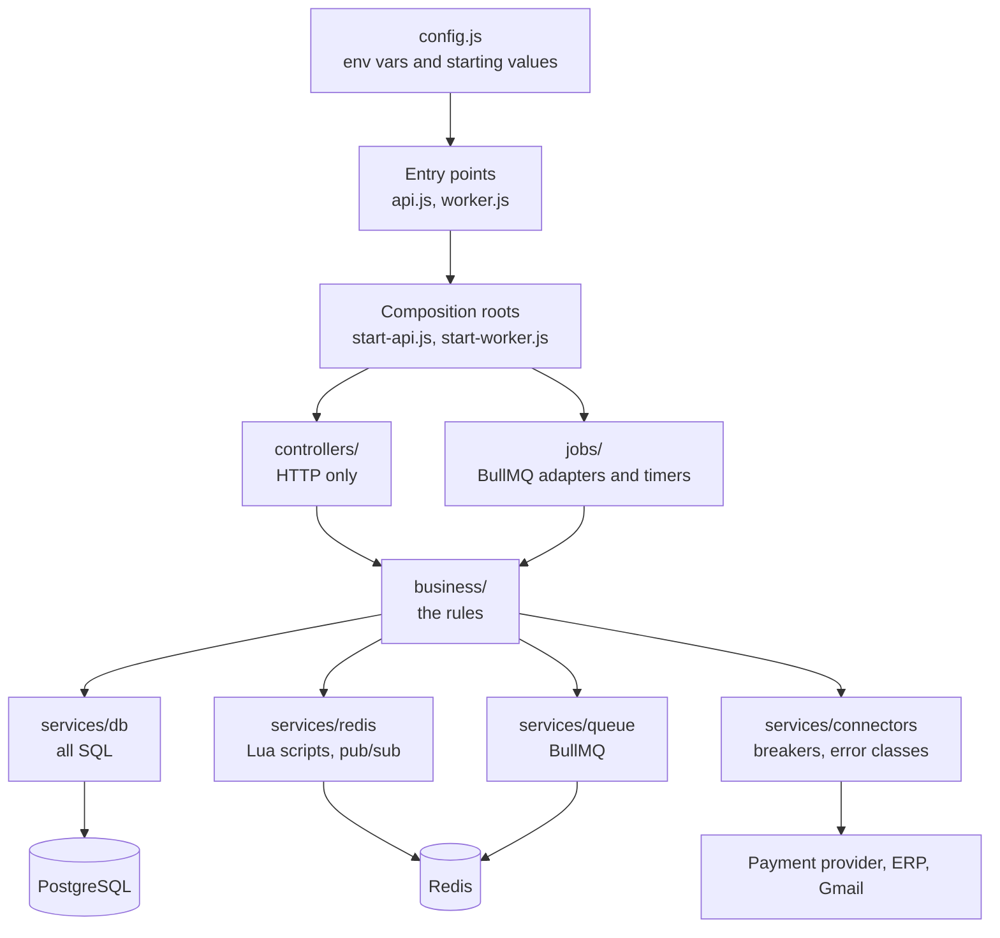
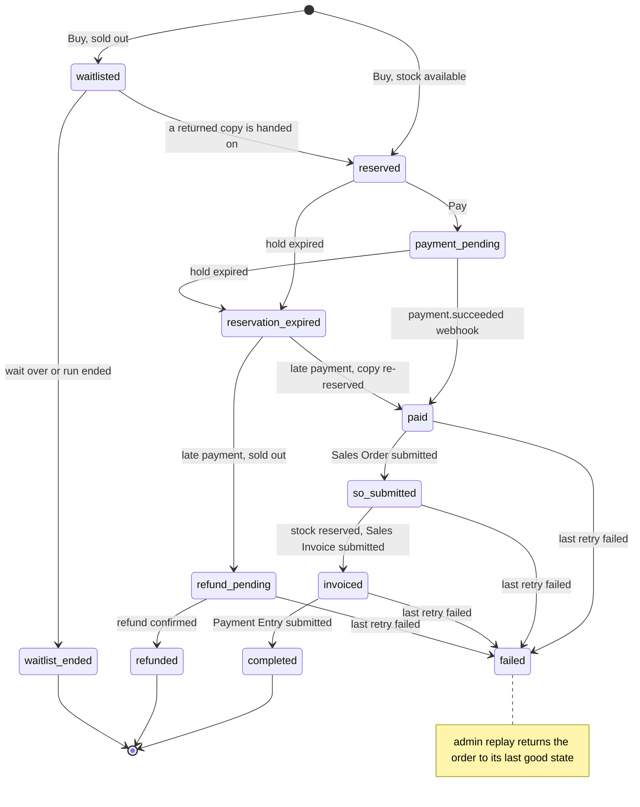
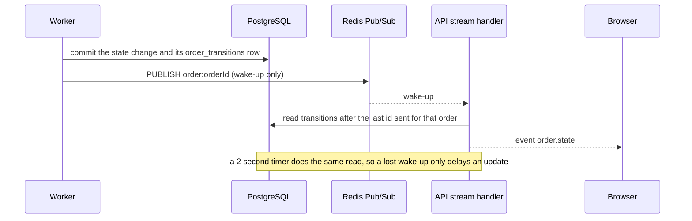
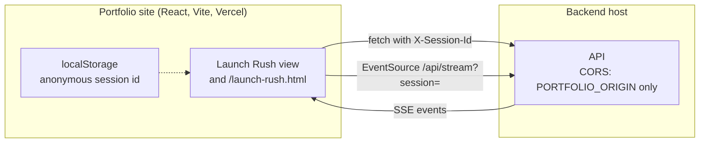
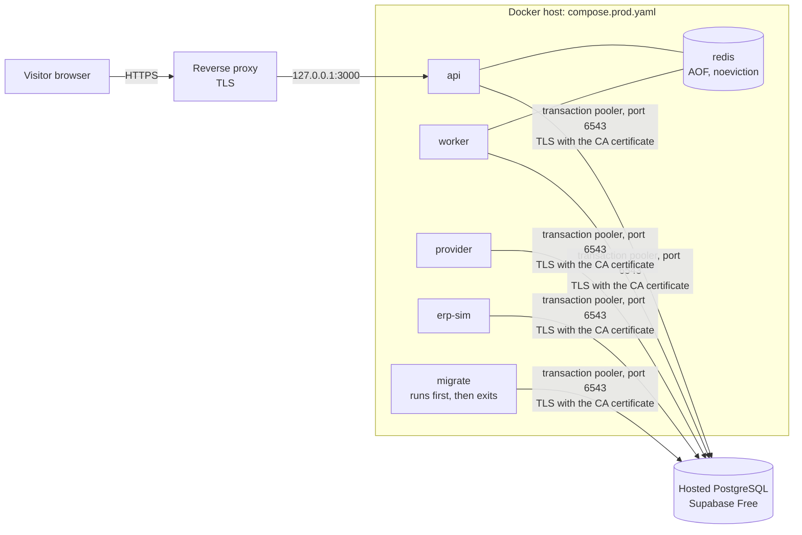

# launch-rush



Live, breakable launch-day order pipeline: no oversell, no lost or double invoices. Node.js, BullMQ, PostgreSQL, ERPNext-style ERP simulator.

> **Demo store: nothing is sold, no game is delivered, no real payment is taken. Not affiliated with or endorsed by any game publisher. Game names are trademarks of their owners.**
> Game names appear as plain text only. The payment provider and the ERP are simulators written for this project.

This is the backend of a portfolio demo. The frontend lives in the portfolio site; this repo holds the API, the worker, the two simulators and the admin page. The full written design (state machine, tables, API contracts, idempotency keys, error handling, SSE) is in [`docs/design-v1.md`](docs/design-v1.md); this README is the map to it and to the code.

**Stack**

| Layer | Technology |
|---|---|
| Runtime and HTTP | Node.js 24, Express 5 |
| Stock gate, queues, limits, pub/sub | Redis 8 (Lua scripts), BullMQ 6, ioredis 6 |
| Record of truth | PostgreSQL (`pg` 8, SQL migrations), 18 locally |
| Resilience | opossum circuit breakers, error classes, idempotency keys |
| Logging | pino (structured JSON) |
| Admin page | React, TypeScript, Vite |
| Load testing | k6 |

## Contents

1. [What it does and what it guarantees](#1-what-it-does-and-what-it-guarantees)
2. [Architecture](#2-architecture)
3. [How one order flows](#3-how-one-order-flows)
4. [Code layout and layering](#4-code-layout-and-layering)
5. [Patterns used, and the problem each one solves](#5-patterns-used-and-the-problem-each-one-solves)
6. [Order state machine](#6-order-state-machine)
7. [Data: PostgreSQL and Redis](#7-data-postgresql-and-redis)
8. [Reliability: retries, errors, replay, recovery](#8-reliability-retries-errors-replay-recovery)
9. [Background jobs](#9-background-jobs)
10. [The simulators](#10-the-simulators)
11. [Demo runs (Rush and Break it)](#11-demo-runs-rush-and-break-it)
12. [Live updates (SSE)](#12-live-updates-sse)
13. [HTTP API summary](#13-http-api-summary)
14. [Admin page](#14-admin-page)
15. [Connection to the portfolio](#15-connection-to-the-portfolio)
16. [Configuration](#16-configuration)
17. [Run it locally](#17-run-it-locally)
18. [Tests](#18-tests)
19. [Deployment](#19-deployment)
20. [Load results and limits](#20-load-results-and-limits)
21. [Trade-offs and known limits](#21-trade-offs-and-known-limits)
22. [License](#22-license)

## 1. What it does and what it guarantees

A visitor picks a game in a demo store and buys one copy. Behind that click the backend does what a launch-day order system has to do: reserve stock first-come-first-served, hold the copy for a few minutes, take a (simulated) payment, accept the payment provider's signed webhook, and then create a Sales Order, a stock reservation, a Sales Invoice and a Payment Entry in an (simulated) ERP. A confirmation email follows. Visitors can also start a **Rush** (hundreds of simulated buyers for one game) and **break** parts of it (slow, failing or rate-limited ERP, duplicate webhooks) and watch the pipeline cope.

The properties the design is built around, and the mechanism behind each:

| Property | Mechanism |
|---|---|
| Never sell more copies than exist | One atomic Redis Lua script is the stock gate; nothing is sold without it (Redis down means `503`, not a guess) |
| First come, first served, including a waitlist | Waitlist is a Redis sorted set; a copy that comes back goes to the earliest waiter |
| An unpaid hold gives the copy back | Expiry sweeper plus a conditional state update, so a copy is returned once |
| A payment after the hold expired is never dropped | Re-reserve a free copy, or move to `refund_pending` and refund |
| A repeated webhook, click or retry changes nothing | Idempotency keys at every boundary ([section 8](#8-reliability-retries-errors-replay-recovery)) |
| No double invoice | One fulfilment job per order, check-then-create in the ERP, `UNIQUE (order_id, doctype)` |
| A failing outside system does not hurt the rest | Per-connector circuit breaker, error classes, retry with backoff, replay from the admin page |
| The scoreboard is not a drawing | A reconciler recomputes it from PostgreSQL and Redis; hard checks (oversold, completed without invoice, stock mismatch) must stay 0 |

These are design goals checked by the tests and by the recorded runs in [section 20](#20-load-results-and-limits), not a promise for every possible failure. The known gaps are listed in [section 21](#21-trade-offs-and-known-limits).

## 2. Architecture



Four Node processes plus Redis and PostgreSQL:

| Process | Entry | Job |
|---|---|---|
| API | `src/api.js` (wiring in `src/start-api.js`) | HTTP for visitors, webhook ingress, SSE, admin API and page |
| Worker | `src/worker.js` (wiring in `src/start-worker.js`) | All asynchronous work: BullMQ workers and the timers in [section 9](#9-background-jobs) |
| Payment provider | `sims/payment-provider/server.js` | Simulates a Stripe-style provider: charges, refunds, signed webhooks with retries |
| ERP simulator | `sims/erp-simulator/server.js` | Simulates ERPNext's REST API and keeps its own data |

The API and the worker are separate so that a slow ERP or a burst of jobs never blocks a visitor's request, and so the API can be restarted without losing queued work (jobs live in Redis). The simulators are separate processes, each with its own PostgreSQL schema (`paysim`, `erpsim`), on purpose: our code talks to them only over HTTP, as it would to a real provider and a real ERP.

Why this stack (details and sources are in the design note):

- **Redis for the stock gate.** A Lua script runs atomically, so "check stock, take one copy, record who holds it" cannot interleave with another buyer. PostgreSQL is the record of what happened, but it is not asked to win a race for the last copy.
- **PostgreSQL as the source of truth.** State changes are conditional `UPDATE`s plus a history row; unique indexes and `CHECK`s enforce the invariants the code relies on.
- **BullMQ for jobs.** Delivery is at-least-once everywhere, so every job is written to be safe when run twice, and job ids double as idempotency keys.
- **SSE, not WebSocket.** The page only needs server-to-browser updates; `EventSource` reconnects by itself.

## 3. How one order flows



1. **Buy** (`POST /api/orders`): a Redis Lua script takes a copy, or adds the buyer to the waitlist, atomically. The API then saves the order as `reserved` or `waitlisted`.
2. **Pay** (`POST /api/orders/:id/pay`, optional email): the order moves `reserved` to `payment_pending` and the API asks the mock provider to charge, with `Idempotency-Key: charge-<orderId>`.
3. **Webhook ingress**: the provider sends `payment.succeeded`, signed with HMAC-SHA256. The API verifies the signature on the raw body, stores the event, enqueues a job and replies 2xx at once.
4. **Webhook job** (worker): `payment_pending` to `paid`, then one fulfilment job with id `fulfil-<orderId>`.
5. **Fulfilment job** (worker), in the ERP simulator: Sales Order (create, submit), reserve stock, Sales Invoice (create, submit), Payment Entry (create, submit); the order becomes `completed`.
6. **Email job** (only if an email was given, or for simulated buyers): Gmail within the cap, else mock.
7. **SSE**: every step above reaches the browser as an event ([section 12](#12-live-updates-sse)).

The failure paths are as much of the design as the happy path:

- **Sold out:** the buyer joins the waitlist (`waitlisted`) and sees a queue position.
- **Hold expires:** the sweeper moves the order to `reservation_expired` and the copy goes to the earliest waiter, or back to stock.
- **Payment arrives late:** the worker tries to re-reserve a copy (only if stock is above 0 and nobody waits). If it gets one the order continues as `paid`; if not the order goes to `refund_pending` and is refunded.
- **PostgreSQL write fails after Redis took a copy:** the API releases the copy before it replies with an error.
- **ERP call fails:** BullMQ retries with backoff; after the last attempt the delivery and the order are marked `failed` and wait for replay.
- **Email fails:** only the email's delivery row is marked `failed`; the order stays `completed`. A Gmail problem must not turn a paid, invoiced order into a failed one.
- **Duplicate webhook:** the event id is a primary key and also the BullMQ job id; a late duplicate that still creates a job finds the order already past `payment_pending` and does nothing.

## 4. Code layout and layering



```
src/
  api.js, worker.js            entry points: load config, build the logger, start, handle SIGINT/SIGTERM
  start-api.js, start-worker.js  composition roots: build every dependency and wire it together
  config.js                    all env vars and starting values, validated once, frozen
  controllers/                 HTTP only: parse, call the business layer, map errors to status codes
  business/                    the rules: orders, payments, fulfilment, stock gate, reconciler, runs, stream, ...
  jobs/                        thin BullMQ adapters (webhook, fulfilment, email) and the timer helper
  services/
    db/index.js                the one repository module: every SQL statement of the app
    redis/                     Redis client, Lua scripts (services/redis/lua), Pub/Sub wake-ups
    queue/index.js             BullMQ queues, job ids, the worker factory
    connectors/                payment-mock, erp-sim, email-gmail, email-mock, circuit breakers, error classification
sims/
  payment-provider/            mock payment provider (own schema paysim)
  erp-simulator/               ERPNext-shaped simulator (own schema erpsim)
db/
  migrate.js, migrations/      SQL migrations 001-020, applied in order
admin/                         the admin page (React + TypeScript + Vite), built to admin/dist
tools/                         catalog export script, k6 load script
test/                          one test file per area (59 files)
docs/                          design note, recorded load results, the diagrams (docs/img)
```

How the layers depend on each other:

- **Controllers** know HTTP (status codes, headers, JSON) and nothing about SQL or Redis. Business errors (`BusinessError`) carry a code; `controllers/errors.js` turns them into the documented `{ "error": { "code", "message" } }` replies. An unexpected error is a `500 internal_error` with no details.
- **Business** modules hold the rules and receive everything they use as arguments (`createOrders({ db, redis, stockGate, payment, config, logger })`). They do not import a database client or read the environment.
- **Services** are the only code that talks to PostgreSQL, Redis, BullMQ or an outside system. All SQL is in `services/db/index.js`, so a reader can find every query in one file and the tests can fake it.
- **Wiring** happens only in `start-api.js` and `start-worker.js` (plain factory functions, no framework). `loadConfig(process.env)` is called only by the entry points; everything else is passed its slice of config, so tests never need a real `.env`.
- **Shutdown** is explicit: the API stops taking requests, ends open streams, lets requests in flight finish, then closes its connections; the worker cancels run jobs (they return to the queue), lets BullMQ finish the jobs in progress, then closes.

## 5. Patterns used, and the problem each one solves

| Pattern | Problem | Where |
|---|---|---|
| Atomic Lua script as a gate | Two buyers racing for the last copy | `services/redis/lua/buy.lua`, `release.lua`, `restock.lua` |
| Conditional `UPDATE ... WHERE state = <expected>` plus a history row | Two workers moving the same order at once; each transition happens once | `db.transition` in `services/db/index.js` |
| Idempotency keys | At-least-once delivery from browsers, providers and queues | [section 8](#8-reliability-retries-errors-replay-recovery) |
| Webhook ingress that verifies, stores, enqueues, replies | A slow handler makes the provider retry; a crash between store and enqueue loses the event | `controllers/webhook.js`, `business/payments.js` |
| Check-then-create in the ERP, keyed by `order_ref` | A retry after a timeout creating a second invoice | `services/connectors/erp-sim.js` |
| Connector interface (`execute`, `classifyError`, `healthCheck`) | Core code that knows about Gmail or an ERP | `services/connectors/` |
| Circuit breaker per connector, and per demo run | A failing ERP hammered by retries; one visitor's faults affecting others | `services/connectors/breaker.js` (opossum) |
| Error classes: retryable, permanent, rate-limited | Deciding retry, stop or wait | `services/connectors/http-errors.js`, jobs |
| Dead-letter plus replay | A failed step must not vanish | failed BullMQ jobs, `deliveries`, admin replay |
| Reconciler | Proving the invariants from the record, not from the UI | `business/reconciler.js` |
| Sweeper and recovery timers | Holds that never get paid; jobs that were lost | `business/waitlist-stock.js`, `business/recovery.js` |
| Repository module | SQL scattered through the code | `services/db/index.js` |
| Dependency injection by factory function | Tests that need real infrastructure for every unit | `create*` functions everywhere |
| Pub/Sub as a wake-up signal only | Redis Pub/Sub can lose messages | `services/redis/wakeups.js`, `business/stream.js` |
| Sandboxed demo runs | One visitor's Break it breaking the demo for everyone | `business/runs.js`, `business/run-driver.js` |

## 6. Order state machine



The full set of transitions:



Happy path: `reserved` to `payment_pending` to `paid` to `so_submitted` to `invoiced` to `completed`.

Side states: `waitlisted` (sold out at Buy), `waitlist_ended`, `reservation_expired`, `refund_pending`, `refunded`, `failed`.

- `completed` means order-to-cash is finished: paid, and Sales Order, Sales Invoice and Payment Entry all submitted. The confirmation email is not a state; it is tracked in its own delivery row and shown as `emailStatus`.
- Every change is a conditional update (`WHERE id = $1 AND state = <expected>`); the caller that changes 0 rows lost the race and does nothing. Each change also writes an `order_transitions` row, which feeds the event log and the SSE stream.
- Retries are not a state: while BullMQ retries a step the order stays in its last state, and the stream sends `delivery.retrying`.
- `failed` is left only by admin replay, which continues from the last good state recorded in `order_transitions`.
- The `CHECK` constraint on `orders.state` limits the column to these names.

The full transition table (trigger for every arrow) is in [design note section 2](docs/design-v1.md).

## 7. Data: PostgreSQL and Redis

**PostgreSQL** is the record of what happened. Migrations `db/migrations/001` to `020` create:

| Schema | Tables |
|---|---|
| `public` | `games`, `sessions`, `demo_runs`, `orders`, `order_transitions`, `payment_events`, `deliveries`, `erp_documents`, `stock_receipts`, `duplicates_blocked`, plus `schema_migrations` |
| `paysim` (payment simulator) | `payments`, `refunds`, `events`, `deliveries` |
| `erpsim` (ERP simulator) | `items`, `customers`, `item_stock`, `documents`, `stock_additions` |

Rules the database enforces, so the code does not have to be perfect:

- `payment_events.event_id` is the primary key: a duplicate webhook is rejected at insert (`INSERT ... ON CONFLICT DO NOTHING`).
- `deliveries` is `UNIQUE (order_id, action)`; `erp_documents` is `UNIQUE (order_id, doctype)`.
- A partial unique index allows one active reservation or wait per session per game in the shop, and one running demo run per session.
- Foreign keys use `ON DELETE CASCADE` where run cleanup needs it, so deleting a run removes its orders and their rows in one statement. Shop orders are never deleted.
- Money is stored as integer minor units plus a currency code. All games are priced in INR.
- The catalog is 85 physical-copy games seeded by migration `012` (generated by `tools/export_catalog.py`; prices and sources are in `tools/catalog_prices.json`).

**Migrations** (`db/migrate.js`): files run in name order, each in its own transaction, guarded by a PostgreSQL advisory lock so two runs cannot apply at once. Each applied file is recorded with a SHA-256 checksum; editing an applied file stops the run, so schema changes always go in a new file.

**Redis** holds what must be fast or atomic, and nothing that cannot be rebuilt from PostgreSQL except the queues:

- Live stock per pool and the reservation records (one per order, **no TTL**: expiry is driven by `orders.reserved_until` and the sweeper, because a TTL would let Redis forget a hold while the copy is still counted as taken).
- The waitlist (sorted set, scores are tickets from a counter, because equal scores sort alphabetically, not by arrival).
- BullMQ queues, rate-limit counters, admin sessions, real-email quota sets, fault settings for the simulator, circuit-breaker states for the admin page, and the Pub/Sub wake-ups.
- Redis runs with `appendonly yes` and `noeviction` (see `compose.yaml`), so queued jobs survive a restart and are never evicted under memory pressure.

A "stock pool" is the shop pool of one game or one demo run's own pool; the same scripts serve both because they receive their keys as arguments.

## 8. Reliability: retries, errors, replay, recovery

**Idempotency keys** (delivery is at-least-once at every boundary):

| Boundary | Key | Mechanism |
|---|---|---|
| Buy (shop) | `(session_id, game_id)` while active | Partial unique index; the `409 already_reserved` body carries the existing order |
| Buy (run) | `(runId, buyer_ref)` | Inside the Lua script |
| Start payment | order id | Conditional update `reserved -> payment_pending` |
| Charge / refund at the provider | `Idempotency-Key: charge-<orderId>` / `refund-<orderId>` | Provider returns the same result for the same key |
| Webhook received | provider event id | `payment_events` primary key and BullMQ `jobId = event id` |
| Fulfilment | `fulfil-<orderId>` | BullMQ job id |
| ERP documents | `order_ref` plus doctype | Check-then-create and `UNIQUE (order_id, doctype)` |
| Email job | `email-<orderId>` | BullMQ job id |
| Real-email quota | order id in the quota sets | Lua script counts an order once |
| Shop restock | `dedupe_key` and receipt id | Unique key; ERP add and Redis add both keyed by receipt id |
| Expiry, wait end, release | order id plus expected state | Conditional update; only the winner returns the copy |

The one honest exception is email: Gmail's send call takes no idempotency key, so if Gmail accepts a message and the worker crashes before recording success, the retry sends a second email. That window is small and cannot be closed without Gmail support; email is **at-least-once, a rare duplicate is possible**. Money and invoices have no such gap.

**Error classes.** Every connector error becomes one of three classes (`classifyError`), and the worker reads only the class:

| Class | Action | Mechanism |
|---|---|---|
| `retryable` (network, timeout, 5xx) | Retry with exponential backoff and jitter | Throw; BullMQ `attempts` and `backoff` |
| `rateLimited` (429 with `Retry-After`, open breaker) | Wait the time asked for without using an attempt | `moveToDelayed` plus `DelayedError` |
| `permanent` (bad data, wrong key, `InsufficientStock`) | Stop now, wait for replay | `UnrecoverableError` |

Starting values: 5 attempts, base delay 2 s with jitter 0.5 (retries come after about 1-2, 2-4, 4-8 and 8-16 s). A delayed job may start at most 50 times, then it fails and waits for replay.

**Circuit breaker** (opossum): one per connector for shop orders and one per connector per demo run. 10 s call timeout, opens at 50% errors over a 10 s window with at least 5 calls, half-opens after 30 s. `permanent` errors do not count against the upstream. An open breaker is `rateLimited`, so jobs wait instead of burning attempts.

**Replay.** A job that failed for good stays in BullMQ's failed set (bounded) and in `deliveries` with its last error. The admin page lists failed deliveries and re-enqueues one with fresh attempts; if the failed job was already removed, replay adds a new job with the same id. The keys above make this safe.

**Recovery.** The code that handles a final failure can itself fail (for example PostgreSQL unreachable at that moment). A timer finds orders that have sat in `paid`, `so_submitted`, `invoiced` or `refund_pending` for over a minute and looks at their queue job: a failed job gets the final-failure handling now, a missing job is added again, a waiting, delayed or active job is left alone.

**Redelivery.** If our endpoint is down for a provider's whole retry window, the payment would stay unknown. A worker timer asks the mock provider to put failed webhook deliveries (up to 24 hours old) back in its queue; ingress dedupes by event id, so a repeat is harmless. Stripe documents the same recovery for undelivered events.

## 9. Background jobs

All run in the worker as `setTimeout` chains (`jobs/timer.js`), so passes of one job never overlap and a failing pass is logged and the next one still runs. Intervals are the defaults in `src/config.js`.

| Job | Every | What it does |
|---|---|---|
| Expiry sweeper | 5 s | Ends expired holds and waits; hands copies to the earliest waiter or back to stock |
| Run closer | 5 s | Ends demo runs that reached their time limit |
| Shop restock | 30 s | A sold-out shop game gets one batch of its starting stock per 10-minute window (ERP first, then Redis, recorded in `stock_receipts`) |
| Reconciler | 10 s | Computes the scoreboard and checks the invariants; also reports leaked holds |
| Recovery | 30 s | Re-drives orders stuck in an ERP or refund step |
| Redelivery | 60 s | Asks the mock provider to resend failed webhook deliveries |
| Email purge | 10 min | Clears `buyer_email` 24 hours after it was saved |
| Run cleanup | 30 min | Deletes finished runs older than 2 hours, with their orders, Redis keys and ERP quantities |

## 10. The simulators

Both are our own code, not the real systems, and both copy the real ones' documented shapes so a real connector could replace them behind the same interface.

**Mock payment provider** (`sims/payment-provider`, own schema `paysim`): `POST /charges` and `POST /refunds` with `Idempotency-Key` (header name and 255-character limit copy Stripe), `POST /payments/:paymentId/resend-webhook` (the "Duplicate" control), `POST /deliveries/redeliver-failed`, `GET /health`. It signs each webhook with `Mock-Signature: t=<unix seconds>,v1=<hex HMAC-SHA256 of "<t>.<raw body>">`, retries a failed delivery with backoff, signs every attempt with a fresh timestamp, and delivers in any order. The API key is a bearer key separate from the webhook secret. Our ingress rejects a signature older than 5 minutes.

**ERP simulator** (`sims/erp-simulator`, own schema `erpsim`): imitates the shape of ERPNext/Frappe's REST API: `/api/resource/:doctype`, `/api/method/frappe.client.submit`, data wrapped in `data` / `message`, `docstatus` 0/1/2, `Authorization: token key:secret`. It is seeded with one Item per game and one Customer, "Demo Customer". Stock reservation is modelled as a Stock Reservation Entry that lowers an available quantity in one conditional update (`409 InsufficientStock` when none is left). Internal routes under `/sim` add stock (keyed by receipt id, so a repeat adds nothing) and delete a run's data. Faults (latency, `down`, rate limit with `Retry-After`, random failure rate) are read from Redis per demo run (`X-Sim-Run` header) or shared for shop orders.

What the ERP simulator does **not** claim: the field names in its request bodies are approximations of ERPNext's and have not been checked against ERPNext's doctype definitions; `order_ref` would be a custom field in real ERPNext; the Reserve call's REST shape is our own, because ERPNext's manual does not document one. These are to be checked when a real ERPNext connector is built.

## 11. Demo runs (Rush and Break it)

Every Rush or Break it action happens inside a **demo run**, a sandbox owned by the visitor's session. It uses the same code paths as the shop (stock gate, webhook ingress, queue, ERP simulator) but never touches shared state:

- its own stock pool in Redis (`stock:run:<runId>`), its own waitlist, its own orders (`orders.run_id`);
- its own ERP quantity, and its own fault settings (`faults:<runId>`) applied by the ERP simulator via `X-Sim-Run`;
- its own circuit breaker per connector, so a run's "ERP down" trips only that run.

A **run driver** in the worker acts for the simulated buyers using the same Buy and Pay logic as the API, but not its HTTP layer (so per-session rate limits do not apply to it). All simulated buyers arrive within the first 10 seconds. Each gets one random behaviour: pays in time (70%), never pays (15%), pays after the hold expired (10%), clicks Buy twice then pays (5%). These shares are configurable starting values, and approximate in practice; the page shows the counts that actually happened.

Caps (configurable starting values in `src/config.js`): one active run per session, up to 500 simulated buyers, stock at most the number of buyers, 5 minutes per run, 3 runs at once across all visitors, a 30-second hold in runs against 5 minutes in the shop (so runs are labelled "accelerated"). The admin kill switch stops every run and blocks new ones. Simulated buyers never send real email.

Run results are labelled "Simulated run" on the page and are not a throughput claim.

## 12. Live updates (SSE)

`GET /api/stream?session=<sessionId>` is one stream per browser tab. The session id is a query parameter because `EventSource` cannot set headers; error logs for this route omit the query string. Events: `order.state`, `email.status`, `waitlist.position`, `delivery.retrying`, `breaker.state`, `run.progress` (at most every 500 ms), `run.ended`, `stock`, `scoreboard`. A heartbeat comment line goes out every 15 s, and `retry: 3000` tells the browser how long to wait before reconnecting. A session may hold 3 streams.

How events get from the worker to the stream, given that Redis Pub/Sub can lose messages:



1. The worker commits the change and its `order_transitions` row in PostgreSQL.
2. It publishes `order:<orderId>` on Pub/Sub. This is only a **wake-up**, never the data.
3. The stream handler reads that order's transitions newer than the last one it sent **for that order** and sends them. It keeps one cursor per order, because sequence ids follow commit order only within one order.
4. A 2-second timer per stream does the same read, so a lost wake-up only delays an update.

Snapshots (`run.progress`, `stock`, `scoreboard`) replace the previous value, so a missed one is corrected by the next. On every new connection the handler sends the current state of each of the session's orders, so after a reconnect the page may skip steps but always shows the current state.

## 13. HTTP API summary

JSON bodies; errors are `{ "error": { "code", "message" } }`. Money is integer minor units plus currency. Full contracts, payloads and error codes are in [design note section 5](docs/design-v1.md).

| Route | Purpose |
|---|---|
| `POST /api/session` | Create an anonymous session (rate limited per IP) |
| `GET /api/games` | Catalog with live stock |
| `POST /api/orders`, `GET /api/orders`, `GET /api/orders/:id` | Buy; my orders; one order card |
| `POST /api/orders/:id/pay` | Start the mock payment |
| `POST /api/orders/:id/resend-webhook` | "Duplicate": resend the payment event (same event id) |
| `POST /api/runs`, `GET /api/runs/:id`, `PUT /api/runs/:id/faults`, `POST /api/runs/:id/stop` | Demo runs |
| `GET /api/stream?session=` | SSE stream |
| `POST /webhooks/payment` | Webhook ingress (raw body, signature verified) |
| `/admin/*` | Owner API and page ([section 14](#14-admin-page)) |

Visitor identity has no cookie: the backend issues a random session id, the frontend keeps it and sends it as `X-Session-Id`. An order is visible only to the session that created it (`404`, not `403`). Limits: 10 new sessions per minute per IP, 120 other calls per minute per session, counted in Redis (fixed window, one Lua script); if Redis cannot be reached the request is allowed, because the stock gate itself refuses sales without Redis.

## 14. Admin page

Served by the API itself at `/admin/`, so its cookie is first-party. It is a React + TypeScript + Vite app in `admin/` (own `package.json`), built to `admin/dist` and served with a Content-Security-Policy that allows only its own origin and forbids framing.

- One owner account. The password is never stored: `ADMIN_PASSWORD_HASH` and `ADMIN_PASSWORD_SALT` hold a scrypt hash (`npm run admin-hash` creates both); comparison is constant-time.
- The session is a random id stored in Redis for 8 hours, sent as an `HttpOnly; Secure; SameSite=Strict; Path=/admin` cookie. Every request that is not GET, HEAD or OPTIONS must also carry the backend's own `Origin` (`ADMIN_ORIGIN`). Login is limited to 5 attempts per minute per IP.
- The `/admin` routes exist only when both hash variables are set; otherwise they answer the normal `404`.
- What it shows and does: connector health and circuit-breaker states, queue depths, the reconciler's scoreboard, failed deliveries with replay, a shop stock refill, the rush kill switch, and the shared ERP faults.
- Gmail is connected with a local script (`npm run gmail-connect`, authorization code flow with PKCE, scope `gmail.send`) rather than an admin route, because an open connect route would let anyone link their own mailbox as the sender.

## 15. Connection to the portfolio

The frontend is a separate repo (the portfolio site, React + Vite + TypeScript, hosted on Vercel). It reaches this backend only over HTTP and SSE:



- **Different origins, so CORS.** `src/controllers/cors.js` allows exactly one origin, `PORTFOLIO_ORIGIN` (default `http://localhost:5173`, the Vite dev server). Preflights are answered with `Allow-Methods: GET, POST, PUT`, `Allow-Headers: Content-Type, X-Session-Id` and `Max-Age: 600`. `Retry-After` is exposed so the page can read it on a `429`. No credentials mode is used.
- **No third-party cookie.** The page stores the session id in `localStorage` and sends it as `X-Session-Id`, because a backend cookie would be third-party on another site.
- **SSE for everything live.** The page opens one `EventSource` on `/api/stream?session=`; a refused stream (unknown session, too many streams) does not reconnect by itself (`EventSource` gives up on any status other than 200), so the page closes it and tries again after a pause.
- **Opt-in at build time.** The demo is in the portfolio build only when `VITE_LAUNCH_RUSH_API` is set to the backend's origin (scheme, host, optional port; no path, no trailing slash). Then the portfolio shows a Launch Rush section whose full-screen view opens inside the page, plus a standalone `/launch-rush.html`. Without the variable the demo's code is not in the portfolio bundle (checked on a build made without it: no API client, `EventSource` or stream URL).
- **CSP.** The portfolio's Content-Security-Policy `connect-src` must list the backend origin. The portfolio's `vite.config.ts` adds the origin to the policy of the production build when the variable is set; the policy that Vercel sends as a header comes from the portfolio's `vercel.json`, which is separate and must be updated together with the variable.
- **Same wording everywhere.** The demo disclaimer is defined once in `src/business/email-content.js` and used by every confirmation email; the demo page carries the same wording.

The message the visitor sees for each error code is in the frontend (`src/launch-rush/api.ts`); the codes are the ones in the design note.

## 16. Configuration

Everything is an environment variable, listed with comments in [`.env.example`](.env.example) and validated at start by `src/config.js` (a wrong value stops the process with a message that names the variable, never its value). Secrets must be at least 32 bytes.

| Group | Variables |
|---|---|
| PostgreSQL | `PGHOST`, `PGPORT`, `PGUSER`, `PGDATABASE`, `PGPASSWORD`, optionally `PGSSLMODE` (read by `pg` itself) |
| Redis | `REDIS_HOST`, `REDIS_PORT` |
| API | `PORT`, optional `API_HOST`, `LOG_LEVEL`, `PORTFOLIO_ORIGIN`, `ADMIN_ORIGIN` |
| Payment provider | `PAYMENT_WEBHOOK_SECRET`, `PAYMENT_API_KEY`, `PAYMENT_PROVIDER_URL`, `PAYMENT_PROVIDER_PORT`, `PAYMENT_WEBHOOK_URL` |
| ERP simulator | `ERP_SIM_URL`, `ERP_SIM_PORT`, `ERP_API_KEY`, `ERP_API_SECRET` |
| Admin | `ADMIN_PASSWORD_HASH`, `ADMIN_PASSWORD_SALT` |
| Gmail (optional) | `GMAIL_CLIENT_ID`, `GMAIL_CLIENT_SECRET`, `GMAIL_ADDRESS`, `GMAIL_REFRESH_TOKEN` |
| Limits (optional) | `RATE_LIMIT_SESSION_CREATE_PER_MIN`, `RATE_LIMIT_SESSION_PER_MIN` |

Tunable values that are not environment variables (hold times, caps, intervals, retry counts, breaker thresholds, run shares) are in `src/config.js` and are **starting values, not tuned numbers**.

Real-email caps: 2 per session and 200 per UTC day, decided by an atomic Redis script when the email job runs. Anything beyond the cap, and every simulated buyer, uses the mock email connector. Every confirmation email has the subject prefix `[DEMO]` and opens with the disclaimer.

## 17. Run it locally

Needs Node.js 24 (developed on v24.22.1; the npm scripts use `--env-file-if-exists`) and Docker.

```
docker compose up -d                 # Redis 8 and PostgreSQL 18 on 127.0.0.1 (local development only)
cp .env.example .env                 # then set PGPASSWORD and the secrets; .env is git-ignored
npm install
npm run migrate                      # applies db/migrations
npm run provider                     # mock payment provider  (own terminal)
npm run erp-sim                      # ERP simulator          (own terminal)
npm run worker                       # worker                 (own terminal)
npm start                            # API on http://127.0.0.1:3000
```

Generate each secret with `node -e "console.log(require('node:crypto').randomBytes(32).toString('hex'))"`. For the admin page: `npm run admin-hash`, paste the two lines into `.env`, then `cd admin && npm ci && npm run build` and open `http://127.0.0.1:3000/admin/`. Gmail is optional; without it every email is simulated.

## 18. Tests

```
npm test
```

59 test files under `test/`, run with Node's built-in test runner, one at a time (`--test-concurrency=1`). They are unit, route and end-to-end tests (order and payment flows, fulfilment, reliability, runs, SSE, admin, simulators) and need the local PostgreSQL and Redis from `docker compose up -d`. **They create and delete rows, so `.env` must never point at a hosted or shared database.** The admin page has its own tests (`cd admin && npm test`).

## 19. Deployment

One image (`Dockerfile`) serves the API, the worker, the payment provider and the ERP simulator, and builds the admin page; `compose.prod.yaml` picks the command per service:

```
docker compose --env-file .env.prod -f compose.prod.yaml up -d --build
```



- Services: Redis 8 (AOF, `noeviction`), a one-shot `migrate` step that runs first, then `api`, `worker`, `provider`, `erp-sim`. Only the API publishes a port, on `127.0.0.1`; put a TLS reverse proxy in front (the admin cookie is `Secure`).
- **Two env files on purpose.** `.env` is for local development and the tests; `.env.prod` (git-ignored) is for the deployment. Keeping them apart is what stops the tests from deleting rows in a hosted database.
- **PostgreSQL is hosted, not a container.** The deployment is set up for a hosted PostgreSQL reached through its **transaction pooler** (port 6543), with TLS: `PGSSLMODE=require` plus the provider's CA certificate (`certs/supabase-ca.crt`, public) mounted and trusted via `NODE_EXTRA_CA_CERTS`, because `pg` treats `require` as full verification. Each transaction in the code runs on one checked-out client and the locks are transaction-level advisory locks (`pg_advisory_xact_lock`), which is why transaction pooling works here.
- **Backups.** `backup.sh` writes a nightly data-only `pg_dump` of the `public`, `paysim` and `erpsim` schemas and keeps 7 days. Restore is: run the migrations on an empty database, truncate the seeded tables, then `pg_restore --data-only --disable-triggers`. A full schema-and-data dump from the hosted service did not restore into plain PostgreSQL in our test, which is why it is data-only.
- Behind a proxy, Express `trust proxy` must be set, or all callers share one rate-limit key. `TRUST_PROXY` is that setting as a hop count (default 0, so a client cannot fake its IP when the API is reached directly); `compose.prod.yaml` sets it to 1 for one reverse proxy in front of the API.

The step-by-step host setup (server size, domain, TLS) is not part of this repo yet.

## 20. Load results and limits

Recorded on 2026-11-16 with k6 against everything on one laptop (Intel Core i5-8250U, 15.9 GB, Docker Desktop); details, settings and raw files are in [`docs/load-results/`](docs/load-results/README.md), the script in [`tools/load/`](tools/load/README.md).

| Target visitors/s | Started | Completed | Not completed in 60 s | Pay to completed (median / p95) |
|---|---|---|---|---|
| 10 | 789 | 789 | 0 | 1.02 s / 1.55 s |
| 50 | 1442 | 1232 | 210 | 26.8 s / 58.7 s |
| 100 | 1845 | 0 | 1844 | none completed in time |

The 50 and 100 runs overloaded that machine (k6 itself dropped iterations), so they are not a throughput figure for any other host. In all three, the reconciler reported oversold 0, orders lost 0, completed without invoice 0.

Not measured: a second machine, a sized server, a run longer than about 2 minutes, SSE under load, the ERP slow/down faults under load, and a flood of calls straight at `/webhooks/payment`. Real Stripe, Gmail and ERPNext are never load-tested. The backend has also been exercised once in Docker against a hosted PostgreSQL in Mumbai (three simultaneous 500-buyer Rush runs through the API, stock 50 each): no errors or warnings in the four services' logs and oversold 0 for each run; that run was driven from a laptop and is not in `docs/load-results/`.

## 21. Trade-offs and known limits

### Decisions and their trade-offs

1. **Redis Lua script as the stock gate, PostgreSQL as the record.**
   *Decision:* the race for the last copy is settled in one atomic script; PostgreSQL stores what happened.
   *Trade-off:* two stores must agree. That costs a compensation step (release the copy if the order insert fails), a reconciler that compares them, and no sales while Redis is down.
2. **Conditional updates instead of locks for state changes.**
   *Decision:* `UPDATE ... WHERE state = <expected>`; the caller that changes 0 rows lost the race.
   *Trade-off:* every caller has to handle the "0 rows" outcome, and every transition needs its expected state spelled out.
3. **Separate API and worker processes.**
   *Decision:* the API handles requests; everything slow runs in the worker from Redis queues.
   *Trade-off:* more processes to run, and live updates must cross a process boundary (Redis Pub/Sub wake-ups).
4. **SSE with wake-ups plus a timer, not data pushed through Pub/Sub.**
   *Decision:* Pub/Sub only says "look again"; the data is read from PostgreSQL.
   *Trade-off:* extra database reads, at least one every 2 seconds per open stream.
5. **No cookies for visitors.**
   *Decision:* an anonymous session id in `localStorage`, sent as `X-Session-Id`, because the frontend and backend are on different sites.
   *Trade-off:* the id is readable by scripts on the page; it is anonymous and only guards demo orders.
6. **Simulators over HTTP with their own database schemas.**
   *Decision:* our code reaches the payment provider and the ERP only through their APIs, as it would the real ones.
   *Trade-off:* the ERP simulator's field names are approximations of ERPNext's and are checked only when a real connector is built.
7. **Email as its own at-least-once job.**
   *Decision:* a Gmail failure never fails a paid, invoiced order.
   *Trade-off:* Gmail's send call has no idempotency key, so a rare duplicate email is possible.
8. **Transaction pooler for the hosted database.**
   *Decision:* port 6543, because each transaction uses one checked-out client and the locks are transaction-level.
   *Trade-off:* the provider's docs list this mode for serverless workloads, not persistent backends; the choice rests on measured runs, not on a statement in the docs. The session pooler (cap of 15 clients) failed under a 3 x 500 Rush in our test.

### Known limits

- **Email is at-least-once** ([section 8](#8-reliability-retries-errors-replay-recovery)): a rare duplicate email is possible.
- **Consistency over availability at the stock gate.** If Redis is unreachable, Buy answers `503`; the system never sells without the gate.
- **Redis is a single instance.** A Redis failure stops selling and queued work waits; there is no failover.
- **Leaked holds are detected, not repaired.** If the process dies between Redis taking a copy and PostgreSQL saving the order, the reconciler reports it (`leakedHolds`) but does not release it automatically, because that could free a copy a late payment is about to take.
- **Starting values are not tuned.** Hold times, caps, intervals and thresholds in `src/config.js` are reasonable starting points, not results of tuning.
- **Simulated everything.** The payment provider and the ERP are simulators; the Gmail connector is the only real outside system, and it is capped. The ERP simulator's field names are approximations of ERPNext's.
- **Run shares are approximate.** A "late" simulated payment that arrives before the sweeper's next pass counts as on time.
- **Single admin account**, one hash in an environment variable, no multi-user model.
- **The hosted database is a free tier** in the reference deployment: it has no automatic backups (hence `backup.sh`), is small, and a free project can pause after a period of inactivity.

## 22. License

[MIT](LICENSE), copyright (c) 2026 Divyansh Sharma.
